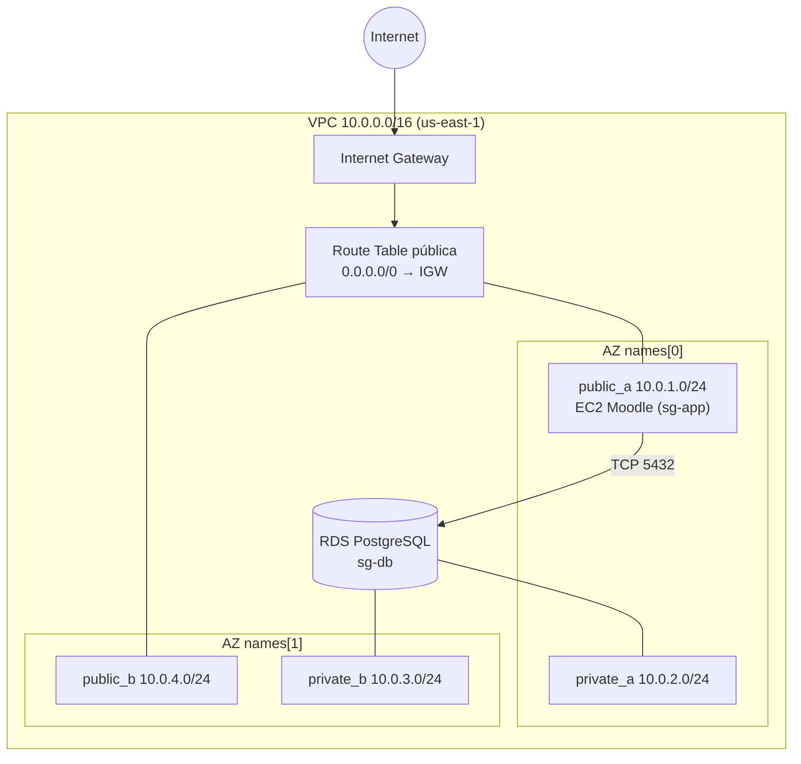

# Design Document

## Overview

O módulo `networking` provisiona a base de rede do Moodle no AWS Academy Learner Lab (região `us-east-1`). Ele cria uma VPC `10.0.0.0/16` com quatro subnets /24 distribuídas em duas AZs, um Internet Gateway, uma Route Table pública e dois Security Groups. Os módulos `compute` e `database` recebem seus IDs de subnet e Security Group por outputs.

Decisões principais:

- **Duas AZs, quatro subnets.** O RDS exige um DB Subnet Group com subnets em pelo menos duas AZs. As subnets públicas também ficam em duas AZs, o que mantém a topologia pronta para um futuro balanceador, embora hoje só `public_a` hospede a EC2.
- **Sem NAT Gateway.** O NAT tem custo por hora e consome o orçamento do Learner Lab. As subnets privadas só abrigam o RDS, que não precisa de acesso à internet.
- **Sem IAM, Route 53, ACM e CloudFront.** O Learner Lab bloqueia ou limita esses serviços. O módulo só declara recursos de rede.
- **Referência entre Security Groups.** O `sg-db` aceita a porta 5432 apenas do `sg-app`. Essa regra continua válida se o IP da EC2 mudar e dispensa CIDRs.

## Architecture

### Plano de endereçamento

Cada subnet usa `cidrsubnet(var.vpc_cidr, 8, n)`, que gera uma /24 a partir da /16. Os índices `n` mantêm os CIDRs previsíveis e sem sobreposição.

| Subnet | `n` | CIDR | AZ | IP público automático |
|---|---|---|---|---|
| public_a | 1 | 10.0.1.0/24 | `names[0]` | Sim |
| private_a | 2 | 10.0.2.0/24 | `names[0]` | Não |
| private_b | 3 | 10.0.3.0/24 | `names[1]` | Não |
| public_b | 4 | 10.0.4.0/24 | `names[1]` | Sim |

As AZs vêm do data source `aws_availability_zones` filtrado por `state = "available"`. O módulo usa `names[0]` e `names[1]`, então não fixa nomes de AZ no código.

### Roteamento

- A Route_Table_Publica contém `0.0.0.0/0` → Internet Gateway e é associada a `public_a` e `public_b`.
- As subnets privadas não têm associação explícita. Elas usam a tabela principal da VPC, que só tem a rota local, portanto sem acesso à internet.

## Components and Interfaces

### Arquivos do módulo

| Arquivo | Conteúdo |
|---|---|
| `terraform/modules/networking/main.tf` | Data source de AZs, VPC, subnets, IGW, route table, associações, Security Groups e regras |
| `terraform/modules/networking/variables.tf` | Variáveis de entrada |
| `terraform/modules/networking/outputs.tf` | Outputs consumidos pelos outros módulos |

### Entradas

| Variável | Tipo | Descrição |
|---|---|---|
| `project_name` | string | Prefixo dos nomes dos recursos |
| `vpc_cidr` | string | CIDR da VPC (padrão na raiz: `10.0.0.0/16`) |
| `ssh_allowed_cidr` | string | CIDR autorizado ao SSH. Sem padrão na raiz e com validação que recusa `0.0.0.0/0` |

A validação fica em `terraform/variables.tf`, na variável raiz `ssh_allowed_cidr`, para falhar já no início do `plan`.

### Saídas

| Output | Valor | Consumidor |
|---|---|---|
| `vpc_id` | ID da VPC | Raiz |
| `public_subnet_id` | ID de `public_a` | Modulo_Compute (`subnet_id`) |
| `public_subnet_ids` | IDs de `public_a` e `public_b` | Reserva para expansão |
| `private_subnet_ids` | IDs de `private_a` e `private_b` | Modulo_Database (DB Subnet Group) |
| `sg_app_id` | ID do SG_App | Modulo_Compute (`security_group_id`) |
| `sg_db_id` | ID do SG_Db | Modulo_Database (`db_security_group`) |

A ligação ocorre em `terraform/main.tf`, onde o módulo raiz passa `module.networking.*` para `compute` e `database`.

### Security Groups

| Grupo | Sentido | Protocolo/Porta | Origem/Destino | Motivo |
|---|---|---|---|---|
| sg-app | Entrada | TCP 80 | `0.0.0.0/0` | Acesso web ao Moodle |
| sg-app | Entrada | TCP 22 | `ssh_allowed_cidr` | Administração restrita ao IP do aluno |
| sg-app | Saída | Todos | `0.0.0.0/0` | Baixar pacotes, clonar o repositório e acessar o RDS |
| sg-db | Entrada | TCP 5432 | sg-app (referência) | Só a EC2 acessa o banco |
| sg-db | Saída | Nenhuma regra explícita | n/a | O RDS não inicia conexões |

As regras usam `aws_vpc_security_group_ingress_rule` e `aws_vpc_security_group_egress_rule`, que tratam cada regra como recurso próprio. Isso evita os conflitos de regras inline do `aws_security_group`.

## Data Models

Não há persistência. O estado dos recursos fica no state do Terraform. Os principais atributos são:

- `aws_vpc.main`: `cidr_block`, `enable_dns_support`, `enable_dns_hostnames`.
- `aws_subnet.*`: `cidr_block`, `availability_zone`, `map_public_ip_on_launch` (só nas públicas).
- `aws_route_table.public`: uma rota `0.0.0.0/0` para o IGW.
- `aws_security_group.app` e `aws_security_group.db`: `name`, `description`, `vpc_id`.

## Error Handling

| Situação | Comportamento |
|---|---|
| `ssh_allowed_cidr = "0.0.0.0/0"` | Validação da variável raiz falha no `plan` com mensagem em português |
| `ssh_allowed_cidr` ausente | Terraform solicita ou falha por variável obrigatória |
| Região com menos de duas AZs disponíveis | `names[1]` falha no `plan`. Em `us-east-1` isso não ocorre |
| Região diferente de `us-east-1` | O Learner Lab bloqueia a criação. `aws_region` tem padrão `us-east-1` |
| Credenciais do Learner Lab expiradas | O provider retorna erro de autenticação. É preciso renovar as credenciais |

## Testing Strategy

Esta feature é Infraestrutura como Código (Terraform). Por isso o design **não inclui seção de Propriedades de Corretude** e não usa testes baseados em propriedades: o módulo é declarativo e não tem função com entradas e saídas sobre as quais valha uma propriedade universal. A verificação usa validações estáticas, testes de estrutura e inspeção do plano.

- **Validações estáticas:** `terraform fmt -check -recursive` e `terraform validate` em `terraform/`.
- **Plano:** `terraform plan` com credenciais do Learner Lab, conferindo que o plano cria VPC, 4 subnets, IGW, route table, 2 associações, 2 Security Groups e suas regras, sem recursos IAM.
- **Testes de estrutura:** os testes em `tests/` (por exemplo `tests/test_terraform_module_structure.py`) verificam a presença dos arquivos do módulo.
- **Evidências:** capturas de tela de `fmt`, `validate` e `plan` anexadas à documentação (ver `docs/evidencias-aula-11.md`).

Atende os Requisitos 1 a 10.
