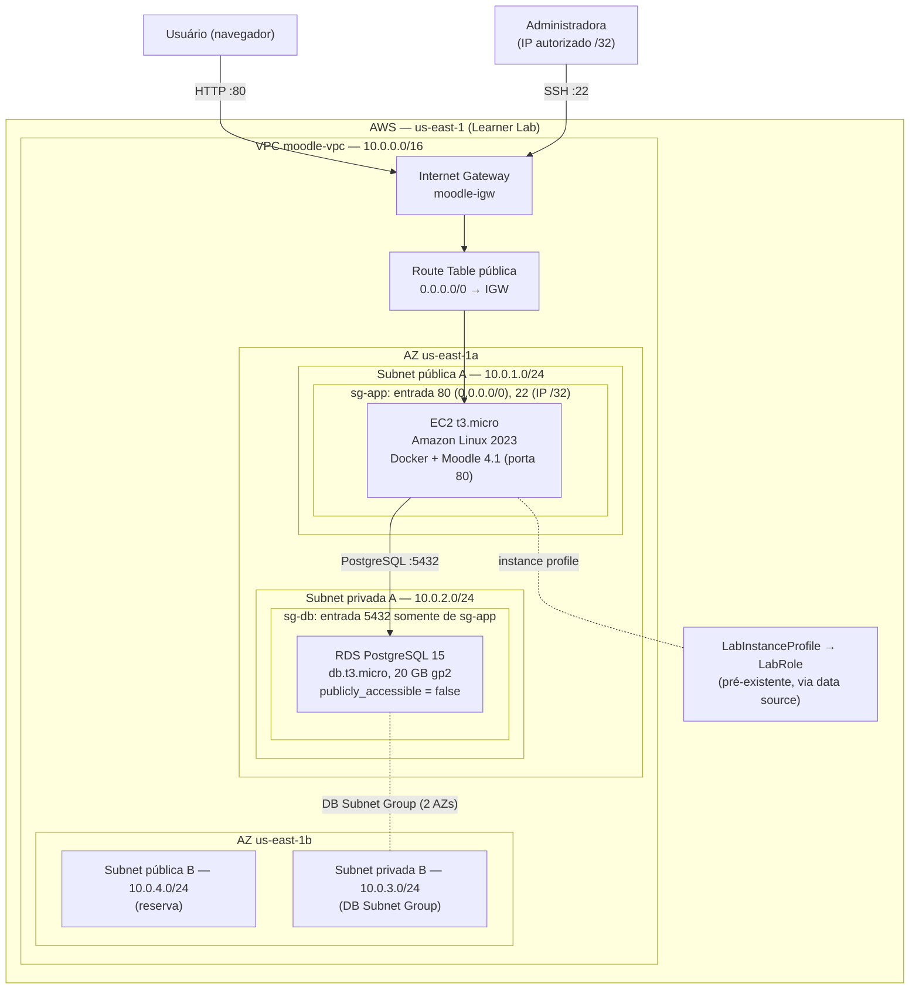

# Design de Arquitetura — Moodle na AWS (Learner Lab)

**Aluna:** Carina Dalpino
**Repositório:** https://github.com/CarinaDalpino/implement_Moodle
**Código Terraform:** [`terraform/`](../terraform/)

---

## Visão Geral

A solução publica o Moodle 4.1 na AWS usando o AWS Academy Learner Lab, na região `us-east-1`. Toda a infraestrutura é criada com Terraform, dividida em três módulos: `networking` (rede e security groups), `database` (RDS PostgreSQL) e `compute` (EC2 que executa o Moodle).

O Moodle roda em contêiner Docker numa instância EC2 `t3.micro` (Amazon Linux 2023) em subnet pública. No primeiro boot, o script `user_data.sh` instala o Docker Engine e o Docker Compose v2, clona este repositório, constrói a imagem a partir do mesmo `docker/Dockerfile` usado no ambiente local e executa `docker compose up -d`. O usuário acessa o Moodle por HTTP na porta 80 do DNS público da EC2.

O banco de dados é um RDS PostgreSQL 15 (`db.t3.micro`) em duas subnets privadas, sem acesso público. Ele só aceita conexões na porta 5432 vindas do security group da EC2. Os dados de conexão (host, porta, nome, usuário e senha) saem do módulo `database` e entram no módulo `compute`, que os grava no `.env` do Moodle dentro da EC2.

As decisões de alto nível foram: reaproveitar o ambiente Docker local na nuvem (mesma imagem), usar um banco gerenciado em rede privada, aplicar o menor privilégio nos security groups e respeitar as restrições do Learner Lab (sem criar IAM, sem Route 53, ACM ou CloudFront).

## Diagrama de Arquitetura

Fluxo de dados: o usuário acessa `http://<DNS público da EC2>`. A requisição entra pelo Internet Gateway, segue a rota da subnet pública e chega à EC2, liberada pelo `sg-app` na porta 80. O Moodle, no contêiner, consulta o RDS na porta 5432 pela rede interna da VPC. O `sg-db` só aceita esse tráfego porque a origem é o `sg-app`. O RDS não tem IP público e não há rota da internet até ele.

## Decisões de Design

| Componente | Escolha | Justificativa |
|---|---|---|
| Tipo de instância EC2 | `t3.micro` | Tipo exigido no enunciado da prova (2 vCPU, 1 GB RAM) e de menor custo no crédito do Learner Lab. Como 1 GB de RAM é pouco para construir a imagem e rodar o Moodle, o `user_data.sh` cria 2 GB de swap antes de instalar o Docker. |
| Engine do banco de dados | RDS PostgreSQL 15 | Mesma versão do ambiente local (`postgres:15` no Docker Compose), o que evita diferenças entre local e nuvem. Por ser gerenciado, a AWS cuida de patches e do armazenamento. |
| Classe da instância RDS | `db.t3.micro` | Menor classe disponível, suficiente para a carga de estudo e com o menor consumo de crédito. Single-AZ e sem backup automático (`backup_retention_period = 0`) pelo mesmo motivo. |
| AMI da EC2 | Amazon Linux 2023 | AMI mantida pela AWS, buscada pelo data source `aws_ami` (sempre a mais recente). Tem Docker no repositório `dnf` e já vem com o cloud-init para executar o `user_data.sh`. |
| Topologia de rede | 2 subnets públicas + 2 privadas, em 2 AZs | A EC2 fica em subnet pública para receber HTTP. O RDS fica em subnets privadas, porque o banco não deve ser acessível pela internet. O DB Subnet Group exige subnets em pelo menos 2 AZs. A segunda subnet pública atende ao enunciado e permite colocar um Load Balancer no futuro. |
| Blocos CIDR | VPC `10.0.0.0/16`, subnets `/24` | Faixa privada RFC 1918 com espaço para crescer. As subnets são calculadas com `cidrsubnet()`, o que evita sobreposição e erro de digitação. |
| Acesso IAM na EC2 | `LabInstanceProfile` via data source | O Learner Lab não permite criar roles nem instance profiles. O código só lê o perfil existente (`data "aws_iam_instance_profile"`), que usa a role `LabRole`. |
| Credenciais do banco | Variável `db_password` com `sensitive = true` | A senha vem do `terraform.tfvars` (ignorado pelo Git) ou de `TF_VAR_db_password`. Nunca aparece no código commitado nem na saída do `plan`. Uma validação exige pelo menos 12 caracteres. |
| SSL do RDS | Parameter group com `rds.force_ssl = 0` | No PostgreSQL 15 do RDS o SSL é obrigatório por padrão, e o instalador do Moodle não configura SSL no cliente, então a conexão seria recusada. É aceitável aqui porque o tráfego só passa dentro da VPC, entre o `sg-app` e o `sg-db`. Em produção, o SSL deve continuar ligado. |
| Implantação do Moodle | `user_data.sh` com `templatefile()` | O mesmo Dockerfile do ambiente local é construído na EC2, então o que foi testado localmente é o que sobe na nuvem. O `templatefile()` injeta os dados do RDS no `.env` sem gravá-los no repositório. |

## Componentes

### VPC

- **Recurso:** `aws_vpc.main`, nome `moodle-vpc`.
- **CIDR:** `10.0.0.0/16`, na região `us-east-1`.
- **DNS:** `enable_dns_support` e `enable_dns_hostnames` ligados. Isso dá à EC2 um DNS público (`ec2-x-x-x-x.compute-1.amazonaws.com`) e permite resolver o endpoint do RDS dentro da VPC.

### Subnets

| Nome | Tipo | CIDR | AZ | Recurso hospedado |
|---|---|---|---|---|
| `moodle-public-a` | Pública | `10.0.1.0/24` | 1ª AZ disponível (ex.: `us-east-1a`) | EC2 do Moodle |
| `moodle-public-b` | Pública | `10.0.4.0/24` | 2ª AZ disponível (ex.: `us-east-1b`) | Reserva (alta disponibilidade futura) |
| `moodle-private-a` | Privada | `10.0.2.0/24` | 1ª AZ disponível | RDS (DB Subnet Group) |
| `moodle-private-b` | Privada | `10.0.3.0/24` | 2ª AZ disponível | RDS (DB Subnet Group) |

As AZs são obtidas pelo data source `aws_availability_zones`, então o código não depende de nomes fixos. As subnets públicas têm `map_public_ip_on_launch = true`. As privadas não têm IP público nem rota para a internet.

### Internet Gateway e Route Table

- **Internet Gateway:** `moodle-igw`, ligado à VPC. É a saída e a entrada da internet.
- **Route Table pública:** `moodle-public-rt`, com a rota `0.0.0.0/0 → moodle-igw`. Está associada às duas subnets públicas.
- **Subnets privadas:** usam a route table principal da VPC, que só tem a rota local `10.0.0.0/16`. Sem NAT Gateway, o RDS não alcança a internet nem é alcançado por ela.

### Security Group — EC2

`moodle-sg-app`:

| Direção | Porta | Protocolo | Origem/Destino | Motivo |
|---|---|---|---|---|
| Entrada | 80 | TCP | `0.0.0.0/0` | Acesso público ao Moodle por HTTP |
| Entrada | 22 | TCP | `var.ssh_allowed_cidr` (IP da aluna `/32`) | Administração por SSH, só do IP autorizado |
| Saída | Todas | Todos | `0.0.0.0/0` | Instalar pacotes, baixar o Docker Compose, clonar o repositório e falar com o RDS |

A variável `ssh_allowed_cidr` tem uma validação que recusa `0.0.0.0/0`.

### Security Group — RDS

`moodle-sg-db`:

| Direção | Porta | Protocolo | Origem | Motivo |
|---|---|---|---|---|
| Entrada | 5432 | TCP | Security group `moodle-sg-app` | Só a EC2 do Moodle conecta no banco |

A origem é o security group da EC2, e não uma faixa de IPs. Assim, qualquer instância fora do `sg-app` é bloqueada, mesmo dentro da VPC. Não há regra com `0.0.0.0/0`.

### Instância EC2

- **Recurso:** `aws_instance.moodle`, nome `moodle-ec2`.
- **Tipo e AMI:** `t3.micro`, Amazon Linux 2023 x86_64 (a mais recente, via `data "aws_ami"`).
- **Rede:** subnet `moodle-public-a`, IP público, security group `moodle-sg-app`.
- **Acesso:** key pair `vockey` (padrão do Learner Lab) e instance profile `LabInstanceProfile` (role `LabRole`).
- **Disco:** 20 GB gp3, criptografado.
- **Metadados:** IMDSv2 obrigatório (`http_tokens = "required"`), que protege contra roubo de credenciais por SSRF.
- **Boot (`user_data.sh`):**
  1. Cria 2 GB de swap.
  2. Instala Docker e Git com `dnf` e habilita o serviço do Docker.
  3. Instala o Docker Compose v2 como plugin do CLI.
  4. Clona este repositório em `/opt/moodle-src`.
  5. Gera `/opt/moodle/.env` (permissão `600`) com os dados do RDS e um `docker-compose.yml` só com o serviço `moodle`, pois o banco agora é o RDS.
  6. Executa `docker compose up -d --build`, publicando o Moodle na porta 80.
- **`user_data_replace_on_change = true`:** se o script mudar, a instância é recriada e o novo script roda.
- **Saídas:** `public_ip` e `public_dns`.

### RDS PostgreSQL

- **Recurso:** `aws_db_instance.main`, identificador `moodle-db`.
- **Engine e classe:** PostgreSQL 15, `db.t3.micro`.
- **Armazenamento:** 20 GB gp2.
- **Disponibilidade:** Single-AZ (`multi_az = false`) para economizar crédito.
- **Rede:** `publicly_accessible = false`, DB Subnet Group `moodle-db-subnets` com `moodle-private-a` e `moodle-private-b` (2 AZs), security group `moodle-sg-db`.
- **Parameter group:** `moodle-pg15` (família `postgres15`), com `rds.force_ssl = 0` (ver Decisões de Design).
- **Ciclo de vida:** `skip_final_snapshot = true`, `deletion_protection = false` e `backup_retention_period = 0`, para o `terraform destroy` funcionar sem sobras no Lab.
- **Saídas:** host, porta, nome do banco, usuário e senha (`sensitive`), consumidos pelo módulo `compute`.

## Segurança

- **Isolamento de rede:** o RDS fica em subnets privadas, sem IP público (`publicly_accessible = false`) e sem rota para a internet. Ele só é alcançável de dentro da VPC.
- **Menor privilégio nos security groups:** o `sg-db` aceita a porta 5432 somente vinda do `sg-app`. O `sg-app` só abre a porta 80 para o público e a 22 para um IP `/32`.
- **SSH restrito:** `ssh_allowed_cidr` é obrigatório, sem valor padrão, e uma validação recusa `0.0.0.0/0`.
- **Credenciais fora do código:** a senha do banco é uma variável `sensitive`, passada por `terraform.tfvars` ou `TF_VAR_db_password`. O `.gitignore` bloqueia `*.tfvars`, `*.tfstate`, `.terraform/` e `.env`. O repositório só tem arquivos de exemplo (`terraform.tfvars.example` e `docker/.env.example`) com valores fictícios.
- **Credenciais da AWS:** as chaves temporárias do Learner Lab ficam em `~/.aws/credentials`, fora do repositório. No GitHub Actions, elas ficam nos secrets `AWS_ACCESS_KEY_ID`, `AWS_SECRET_ACCESS_KEY` e `AWS_SESSION_TOKEN`.
- **IAM:** nenhum recurso IAM é criado. A EC2 usa o `LabInstanceProfile` existente, lido por data source.
- **Na EC2:** IMDSv2 obrigatório, disco criptografado e `.env` com permissão `600`.
- **Limitação conhecida:** a senha do banco vai no `user_data`, que pode ser lido por quem tem acesso ao console ou à API da EC2, e também fica no estado do Terraform. No Lab isso é aceito. Em produção, a senha deveria ficar no AWS Secrets Manager ou no SSM Parameter Store e ser lida pela EC2 no boot. O estado deveria ficar num backend remoto criptografado (S3 com DynamoDB para lock).
- **Sem HTTPS:** o Learner Lab não permite ACM nem Route 53, então o acesso é só por HTTP na porta 80. Em produção, o certo seria um Application Load Balancer com certificado do ACM.

## Escalabilidade

**Limitações atuais (Learner Lab):**
- Uma única EC2 `t3.micro` em uma AZ. Se a instância ou a AZ cair, o Moodle fica fora do ar.
- RDS `db.t3.micro` Single-AZ, sem backup automático.
- Os arquivos do Moodle (`moodledata`) ficam num volume Docker no disco da EC2. Por isso não dá para ter mais de uma instância servindo o mesmo site.
- As credenciais do Lab expiram em cerca de 4 horas, e a sessão do Lab desliga os recursos ao terminar.

**Como escalar em produção:**
- **Aplicação:** Application Load Balancer nas duas subnets públicas e Auto Scaling Group com Launch Template, usando EC2 em subnets privadas e NAT Gateway para a saída.
- **Arquivos compartilhados:** `moodledata` no Amazon EFS, montado por todas as instâncias.
- **Banco:** RDS Multi-AZ, com backup automático e réplicas de leitura se necessário.
- **Cache e sessões:** Amazon ElastiCache (Redis), que o Moodle suporta.
- **HTTPS e DNS:** ACM no Load Balancer e Route 53 para um domínio próprio.

**Mudanças no Terraform:**
- **`networking`:** adicionar NAT Gateway, route table privada e security group do ALB. O `sg-app` passaria a aceitar a porta 80 só do ALB.
- **`compute`:** trocar `aws_instance` por `aws_launch_template` e `aws_autoscaling_group`, e adicionar `aws_lb`, `aws_lb_target_group` e `aws_lb_listener`.
- **`database`:** `multi_az = true`, `backup_retention_period` maior que zero e `deletion_protection = true`.
- **Novos recursos:** `aws_efs_file_system` e `aws_elasticache_replication_group`.
- **Estado:** backend remoto em S3 com DynamoDB.

## Custo Estimado

Valores On-Demand de referência em `us-east-1`, considerando uso contínuo (730 horas/mês). No Learner Lab o custo sai do crédito do curso e os recursos só ficam ligados durante as sessões, então o gasto real é bem menor.

| Serviço | Tipo/Configuração | Custo estimado (USD/mês) |
|---|---|---|
| EC2 | `t3.micro`, On-Demand, 730h (US$ 0,0104/h) | 7,59 |
| RDS PostgreSQL | `db.t3.micro` Single-AZ, 730h (US$ 0,018/h) | 13,14 |
| Armazenamento RDS | 20 GB gp2 (US$ 0,115/GB-mês) | 2,30 |
| Armazenamento EBS (EC2) | 20 GB gp3 (US$ 0,08/GB-mês) | 1,60 |
| IPv4 público da EC2 | 1 endereço, 730h (US$ 0,005/h) | 3,65 |
| Transferência de dados | 10 GB saída (primeiros 100 GB/mês gratuitos) | 0,00 |
| VPC, subnets, Internet Gateway, route tables e security groups | Sem cobrança | 0,00 |
| **Total estimado** | | **28,28** |

> Referência: [AWS Pricing Calculator](https://calculator.aws/) — use o link para obter valores atualizados e gerar um link compartilhável da sua estimativa.

Estimativa gerada na AWS Pricing Calculator: [link da estimativa](https://calculator.aws/)