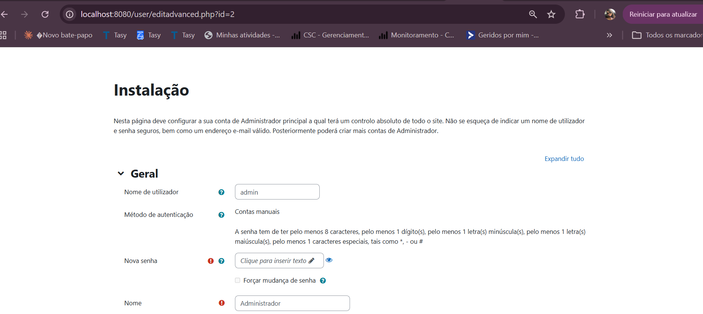
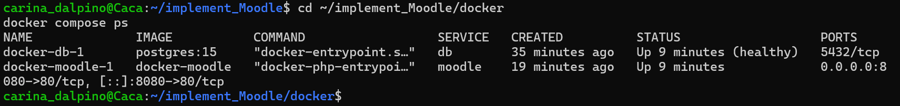

# Evidências — Aula 11 (Moodle local com Docker)

**Data da verificação:** 18/11/2026 (20:04, UTC-3)
**Commit com a correção:** 5894d78 (`docker/Dockerfile`, extensão `pgsql`)

## Contêineres em execução

Comando: `docker compose -f docker/docker-compose.yml ps`

```
NAME              IMAGE           SERVICE   STATUS                    PORTS
docker-db-1       postgres:15     db        Up 17 minutes (healthy)   5432/tcp
docker-moodle-1   docker-moodle   moodle    Up 17 minutes             0.0.0.0:8080->80/tcp
```

## Resposta HTTP

Comando: `curl -s -o /dev/null -w "HTTP %{http_code} redirect=%{redirect_url}" http://localhost:8080/`

```
HTTP 303 redirect=http://localhost:8080/admin/index.php
```

## Versões

- PHP 8.1.34
- PostgreSQL 15.20
- Extensões PHP carregadas na imagem: `pgsql` e `pdo_pgsql`

## Prints

- `docs/img/print-moodle.png`: Moodle aberto em http://localhost:8080 (tela de Instalação, configuração da conta de administrador).
- `docs/img/docker.png`: saída do `docker compose ps` com os serviços `db` (healthy) e `moodle` (Up) na porta 8080.



